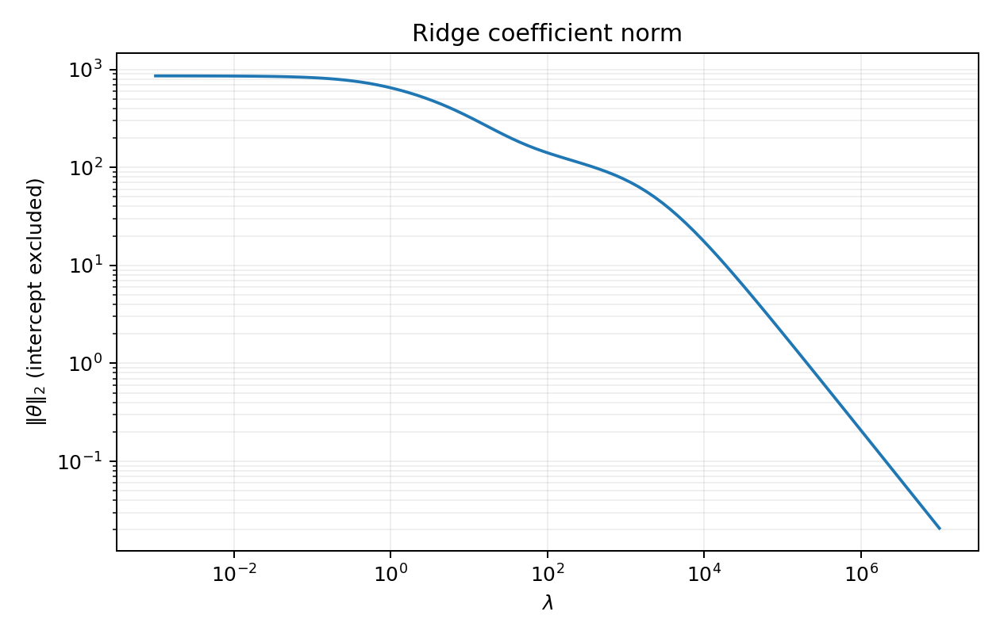
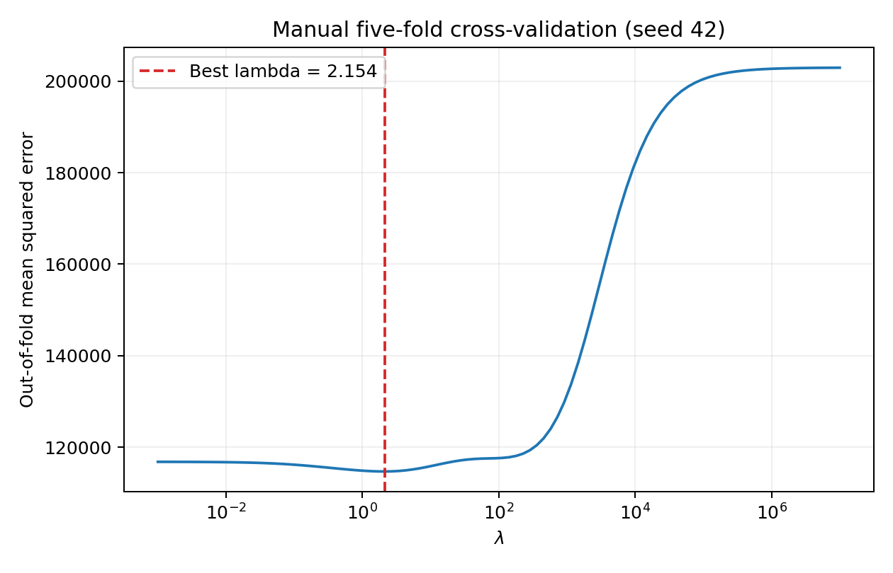

# Machine Learning and Optimization — Problem Set 2
## Problem 1: Ridge regression and cross-validation

## 1. Feature scaling
The features have very different scales: career totals can be thousands, annual counts are smaller, and indicator variables are 0 or 1. Ridge penalizes coefficient magnitudes, which depend on the measurement units. Without scaling, a large-scale feature needs a smaller coefficient for the same predictive effect and is consequently penalized less. Standardizing makes shrinkage comparable across features.

## 2. Closed-form solution with an unpenalized intercept
Let A = [1 Z], beta = (b, theta), and D = diag(0, 1, ..., 1). We minimize
    J(beta) = ||y - A beta||_2^2 + lambda * beta^T D beta.
The normal equations are (A^T A + lambda D) beta = A^T y, so
    beta_hat = (A^T A + lambda D)^(-1) A^T y.
The same expression applies to the assignment's augmented matrix [1 X]; here X has first been standardized. D leaves the intercept unpenalized. The implementation solves this linear system rather than explicitly forming the inverse. For lambda > 0 it has a unique solution: a zero quadratic form would require both theta = 0 and b*1 = 0.
Because Z has zero column means, b_hat = mean(y), and theta_hat = (Z^T Z + lambda I)^(-1) Z^T(y - mean(y)).
Convention: the squared-error loss above is a sum, with no division by n. Under the alternative objective mean squared error + alpha * ||theta||^2, alpha = lambda/n for the same training data. Numerical lambda values must be interpreted with this convention.

## 3. Coefficient norm along the regularization path
The grid is lambda_j = 10^(-3 + 10*j/99), j = 0, ..., 99. The first plot shows ||theta_hat||_2 against lambda with logarithmic axes; the intercept is excluded. All 99 successive differences in the norm are nonpositive within numerical tolerance.
This monotonicity also follows from optimality. If 0 < lambda_1 < lambda_2 and theta_1, theta_2 are the respective minimizers, adding their two optimality inequalities gives (lambda_2-lambda_1)(||theta_2||^2-||theta_1||^2) <= 0. Thus the norm cannot increase as lambda increases. The objective penalizes the squared norm; the requested plot displays the norm itself.

## 4. Small- and large-lambda limits
At lambda = 1e-8, the Euclidean difference between the augmented ridge and least-squares coefficients is 5.256987e-06, a relative difference of 5.1798283e-09. Least squares is computed independently using numpy.linalg.lstsq. At the required grid endpoint lambda = 1e-3, the absolute coefficient difference is 0.524964; the still smaller lambda demonstrates the limiting behavior more clearly.
At lambda = 1e12, ||theta_hat||_2 = 2.0720445e-07, while b_hat = 535.92584411. At the grid endpoint lambda = 1e7, the slope norm is 0.02071657. Thus all slopes approach zero and the prediction approaches the constant mean salary, rather than zero. In the centered formula, the eigenvalues of (Z^T Z + lambda I)^(-1) go to zero as lambda grows, proving the result.

## 5. Manual five-fold cross-validation
Use numpy.random.default_rng(42) to permute row indices, then numpy.array_split to create disjoint folds of sizes 53, 53, 53, 52, 52. For each lambda and fold, fit standardization on the other four folds, solve the ridge system on those training observations, and predict the held-out observations. No held-out target or feature statistic is used in fitting.
The score is pooled out-of-fold 114713.077893: CV(lambda) = (1/263) * sum_i (y_i - prediction_i_from_held_out_fold(lambda))^2. This weights folds by their sizes. Choose the grid point with the smallest score, then refit using all observations and full-data scaling.
The selected lambda is 2.15443469. Its cross-validation 114713.077893 is 114713.077893 (thousand dollars)^2, and R114713.077893 is R114713.077893 thousand dollars. The plot shows the complete grid. Fold assignments and all per-fold scores are saved for reproducibility. A different random partition or scaling convention can select a different grid point. This is a tuning score, not an unbiased independent test-set estimate after model selection; the exercise provides no separate test set.

## 6. Final coefficients and coaching interpretation
The table below gives the refitted coefficients for standardized features and for original feature units. For a standardized feature, the coefficient is the fitted salary difference associated with a one-standard-deviation increase while holding other predictors fixed. For a binary feature, its original-units coefficient describes the full 0-to-1 change. The standardized intercept is the fitted salary at mean feature values.
The original-units slopes are theta_j/s_j and the original-units intercept is b - sum_j mu_j*theta_j/s_j. Both parameterizations give identical predictions.

| Feature | Standardized coefficient | Original-units coefficient |
|---|---:|---:|
| Intercept | 535.925844 | 151.014125 |
| AtBat | -243.242974 | -1.654411 |
| Hits | 261.711860 | 5.810724 |
| HmRun | 8.250934 | 0.943995 |
| Runs | -12.058313 | -0.473038 |
| RBI | -0.670097 | -0.025939 |
| Walks | 115.188986 | 5.313947 |
| Years | -47.736338 | -9.977302 |
| CAtBat | -142.652289 | -0.062506 |
| CHits | 125.718010 | 0.194319 |
| CHmRun | 53.218355 | 0.648679 |
| CRuns | 245.959348 | 0.744050 |
| CRBI | 129.418440 | 0.400984 |
| CWalks | -163.670003 | -0.621013 |
| LeagueN | 30.657633 | 61.415236 |
| DivisionW | -61.196818 | -122.415761 |
| PutOuts | 78.146208 | 0.279691 |
| Assists | 42.883101 | 0.296145 |
| Errors | -24.617609 | -3.733333 |
| NewLeagueN | -13.841256 | -27.755036 |

A practical handful of attributes to emphasize would be: hitting reliably (Hits), producing runs over a sustained career (CRuns), reaching base through walks (Walks), and contributing defensively (PutOuts). Hits and CRuns have the largest positive standardized coefficients; Walks and PutOuts also have positive coefficients. Career hits, career RBI, and career home runs supply related evidence for sustained offensive production.
These are predictive associations, not causal coaching effects. Annual and career measures are strongly related, so individual coefficients can change as correlated predictors share explanatory power. For example, the negative AtBat coefficient does not mean a player should avoid batting; conditional on the same number of hits and other statistics, additional at-bats can reflect weaker efficiency. Similarly, negative career-walk or years coefficients should not be interpreted as evidence that walking or experience reduces pay. Career totals are accumulated outcomes, not independently manipulable skills. League and division indicators are context rather than player attributes. Coaching advice should therefore focus on the broad skills above, without promising a salary increase from this model.

## Reproduction and validation
Run `python solution.py` from this directory (or use its absolute path). Required runtime dependencies: NumPy and Matplotlib. To regenerate this report, run `python write_report.py` with ReportLab installed. No network service or credentials are needed.
Validation passed: expected input dimensions and finite values; strictly positive feature scales; monotone coefficient norms; tiny-lambda agreement with least squares; large-lambda shrinkage and mean intercept; exhaustive disjoint held-out folds; equality of standardized and original-units predictions; and agreement of the final coefficients with an independent centered singular-value-decomposition calculation.
